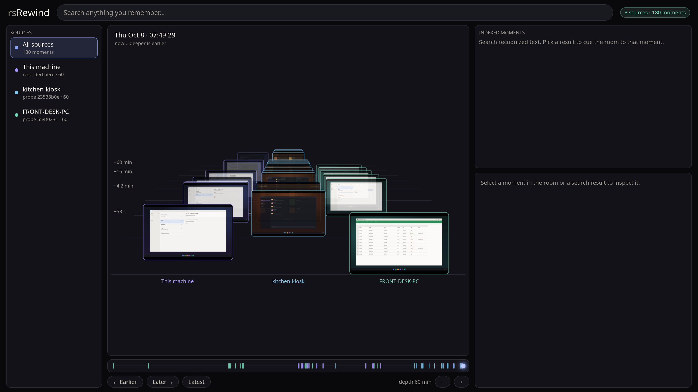

# rsRewind

Find something you saw, even when you cannot remember where you saw it.

rsRewind keeps a searchable visual history of your screen on your own computer. Remember a few words? Search them, jump back to that moment, and look at what happened around it. Recording and text recognition run locally, with no account or telemetry.

**Current release: v0.0.9** · [Get rsRewind](https://spilloid.github.io/rsRewind/install.html) · [First few minutes](https://spilloid.github.io/rsRewind/guide.html) · [Website](https://spilloid.github.io/rsRewind/)

*Real Windows app, made-up history. Development builds have an updated viewer; Mac desktop acceptance is still pending.*

## Choose your platform

| Platform | What you can get today |
|---|---|
| **Windows 11 · x64** | [Signed per-user installer or portable ZIP](https://spilloid.github.io/rsRewind/install.html#windows), v0.0.9. Windows 10 is unverified. |
| **Linux · x86-64** | [v0.0.9 AppImage](https://spilloid.github.io/rsRewind/install.html#linux). Recording requires KDE Plasma 6 on Wayland; install Tesseract for text search. Verified on one machine. |
| **macOS 14+ · Apple Silicon** | [Development preview](docs/macos.md). Native ARM64 app compiles and passes hosted tests. Ad-hoc signed, not notarized; real-Mac capture and UI acceptance remain pending. No Intel build. |

## Your first few minutes

1. Install for your platform and open **rsRewind** from your search or application menu; it starts the tray icon and recording, then opens the window.
2. Use a harmless test session. Choose **Start recording**, then open a text document with a distinctive phrase such as “violet bicycle.”
3. Give text recognition a little time, then search for that phrase in rsRewind. Pick a result to return to its screenshot.
4. Use the tray or menu-bar controls to pause, resume or stop recording. Closing the viewer does **not** stop the background recorder.

[The everyday guide](https://spilloid.github.io/rsRewind/guide.html) covers navigation, startup, storage and troubleshooting.

> **Early release: use a session you are comfortable recording.** History is unencrypted, and [known privacy gaps](https://github.com/spilloid/rsRewind/issues/12) remain open. Exclusions and pause controls are not a guarantee that sensitive content can never be stored. Read [privacy and data handling](PRIVACY.md) before recording your normal desktop.

## Make it yours

- **Find a moment:** search recognized screen text, inspect the full screenshot, and move backward or forward through your history.
- **Keep control:** visible recorder state, pause and stop controls, configurable exclusions and retention. Defaults keep 90 days with a 50 GB soft storage limit.
- **Bring another computer:** [export and import history](https://spilloid.github.io/rsRewind/probes.html) into one view. Transfers are manual; integrity checks do not authenticate the sender.
- **Connect an assistant:** [optional MCP access](docs/mcp.md) in development builds. Off by default; returned history can reach the assistant provider.
- **Go deeper:** [CLI and storage reference](docs/cli.md), [architecture](ARCHITECTURE.md), [build instructions](docs/development.md).

Screenshots and recognized text stay in your local store unless you export them or enable an integration that shares them. rsRewind captures screen pixels and available window metadata; it does not record keystrokes or audio. Platform support and privacy enforcement have limits described in the linked guides.

## Help and development

[Documentation](docs/README.md) · [Release notes](CHANGELOG.md) · [Known issues](https://github.com/spilloid/rsRewind/issues) · [Roadmap](ROADMAP.md) · [Contributing](CONTRIBUTING.md)

MIT licensed. Releases include third-party notices; see [licensing](docs/licensing.md).
